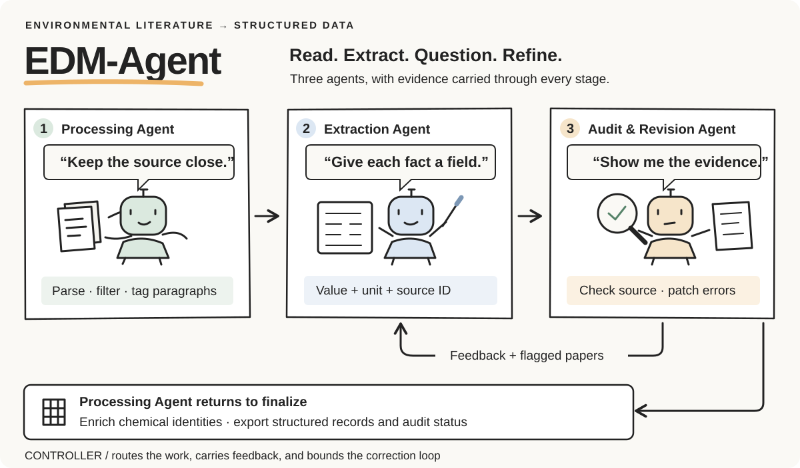

<p align="center">
  
</p>

<p align="center">
  <a href="#how-the-team-works">The agents</a> ·
  <a href="#design-choices">The design</a> ·
  <a href="#the-photochemistry-corpus">The corpus</a> ·
  <a href="#use-the-code">Get started</a> ·
  <a href="https://huggingface.co/HJL-DLUT/EPSciBERT">EPSciBERT</a>
</p>

EDM-Agent turns aquatic photochemistry papers into structured kinetics records. Three agents divide the work: one prepares the evidence, one extracts the data, and one independently checks the draft against the paper. A controller carries corrections through the loop and coordinates the final export.

Code accompanying **Self-Auditing Multi-Agent Data-Mining System for Transforming Decades of Environmental Photochemistry Literature into AI-Ready Datasets**.

## How the team works

| Agent | Its job | What it passes on |
| --- | --- | --- |
| **Processing** | Parse papers, identify relevant passages, and tag source paragraphs. Return after auditing to enrich chemical identities and export the records. | Source-tagged text → structured spreadsheets |
| **Extraction** | Read the prepared text and fill a typed schema for chemicals, irradiation conditions, water matrices, and kinetics. | A structured draft with values, units, and source IDs |
| **Audit & Revision** | Read the original evidence alongside the draft, identify discrepancies, and propose specific changes. | Validated patches or correction feedback |

The audit has two correction routes. Small errors receive local patches. Larger problems send the affected papers back to extraction with explicit feedback. The controller bounds the number of iterations and preserves processing and audit status with the run outputs.

## Design choices

- **Keep the evidence attached.** Extracted fields carry paragraph IDs, so a result can be traced back to the text that supports it.
- **Check meaning and structure separately.** The auditor compares the scientific content with the source; Pydantic checks field types and the record structure.
- **Make corrections precise.** Stable experiment and data-point IDs locate each patch. Changes are applied to a working copy and validated before replacing the record.
- **Spend retries where they matter.** Re-extraction targets flagged papers and receives the auditor's feedback. A bounded loop keeps the workflow manageable across a literature collection.

## The photochemistry corpus

The environmental photochemistry corpus was assembled from Web of Science searches completed on **22 August 2024**. The search covered photochemical processes in chemistry, environmental sciences and ecology, and public, environmental and occupational health, restricted to research articles.

| Collection stage | Scale |
| --- | ---: |
| Search results | 270,361 records |
| Unique publications with a DOI and abstract | 232,519 |
| Acquired full-text articles | 178,166 |
| Domain-pretraining text | ~4.51 billion characters |
| SciBERT tokenizer tokens | ~1.07 billion |

The full-text collection comprises **83,914 XML**, **56,506 HTML**, and **37,746 PDF** articles. Its publisher distribution is **Elsevier 83,914; Springer Nature 20,466; RSC 19,760; Wiley 18,154; other publishers 35,872**.

The corpus covers photolysis, photodegradation, photochemical transformation, photosensitization, photooxidation, photoreduction, and related processes. Parsed article text supports continued masked-language-model pretraining of EPSciBERT. Character counts include spaces and line breaks; character and token totals are rounded values reported in the accompanying manuscript.

## Use the code

```text
system/backend/     Agents, controller, schemas, prompts, and desktop bridge
system/frontend/    Desktop interface
machine_learning/   Regression training, prediction, and endpoint parameters
```

<details>
<summary><strong>Install and run the multi-agent system</strong></summary>

### Install

Use Python 3.10–3.12. The desktop interface is primarily intended for Windows.

```powershell
python -m venv .venv
.\.venv\Scripts\Activate.ps1
python -m pip install -r requirements.txt
```

For the multi-agent application alone, install `system/backend/requirements.txt`. For regression modeling alone, install `machine_learning/requirements.txt`.

### Configure the agents

```powershell
Copy-Item system/backend/.env.example system/backend/.env
```

Edit `system/backend/.env` and set `MINERU_API_TOKEN` for PDF parsing. Choose the provider and model for each LLM stage using `STEP1_LLM_PROVIDER`, `STEP2_LLM_PROVIDER`, `STEP3_LLM_PROVIDER`, and the corresponding provider-specific model fields. Model names must be available through your provider account.

| Provider | Credential variable |
| --- | --- |
| `openai` | `OPENAI_API_KEY` |
| `deepseek` | `DEEPSEEK_API_KEY` |
| `qwen` | `QWEN_API_KEY` |
| `openrouter1` | `OPENROUTER1_API_KEY` |
| `openrouter2` | `OPENROUTER2_API_KEY` |
| `zhipu` | `ZHIPU_API_KEY` |
| `chatai` | `CHATAI_API_KEY` (extraction stage) |

ChemSpider and CompTox keys are optional enrichment settings. No credentials are distributed with the code. API request limits, worker counts, reasoning options, and structured-output settings can be configured in the same file.

### Run the system

Place the input papers in `system/data/00_input_pdfs/`, then launch the desktop interface:

```powershell
python system/backend/tdm_bridge.py
```

The interface supports starting, pausing, resuming, and selecting pipeline stages. The command-line entry point runs the full pipeline:

```powershell
python system/backend/0_start.py --mode full
```

| Stage | Operation |
| --- | --- |
| 1 | PDF parsing with MinerU |
| 2 | Parsed JSON collection |
| 3 | Source identifier assignment |
| 4 | Relevance filtering |
| 5 | Extraction input assembly |
| 6 | Structured kinetics extraction |
| 7 | Independent auditing and targeted correction |
| 8 | Chemical enrichment and spreadsheet export |

Run-specific outputs are written under `system/data/runs/`. The final spreadsheet is in the run's `08_final_excel/` directory. The controller retains the extraction–audit feedback loop and pause/resume handling. Runtime summaries report processing status and API usage.


</details>

<details>
<summary><strong>Train and use a kinetics regressor</strong></summary>

### Train a kinetics regressor

Provide a prepared CSV containing numeric feature columns and a numeric target column, named `target_model` by default. Supply only the feature columns intended for fitting. Handle molecular descriptors, categorical encoding, missing values, and any scaling before passing the table to this entry point. The features used for prediction must have the same names, order, and transformations as the training features. For the kinetics endpoints, `target_model` is `log10(result_value)`.

```powershell
python machine_learning/modeling.py train --input prepared_hl_train.csv --endpoint hl --seed 42 --output outputs/hl_model.joblib
python machine_learning/modeling.py predict --input prepared_hl_predict.csv --model-file outputs/hl_model.joblib --output outputs/hl_predictions.csv
```

Prediction files contain `prediction_model`, in the same target scale used for training. Use `10 ** prediction_model` when the target was log10-transformed.

| Endpoint preset | Selected model |
| --- | --- |
| `hl` | XGBoost |
| `kp` | LightGBM |
| `qy_new_log10` | Extra Trees |
| `kp_augmented_hl` | XGBoost |

Endpoint presets use the selected estimator parameters supplied in parameters.json.

The six regression families reported in the manuscript are Ridge, Random Forest, Extra Trees, LightGBM, XGBoost, and CatBoost. The estimator module also retains the source implementation’s Elastic Net and SVR options. To use an estimator's original defaults instead of an endpoint preset:

```powershell
python machine_learning/modeling.py train --input prepared_train.csv --model random_forest --output outputs/model.joblib
```


</details>

## EPSciBERT

[EPSciBERT on Hugging Face](https://huggingface.co/HJL-DLUT/EPSciBERT) provides the environmental photochemistry domain-adapted masked-language-model checkpoint and tokenizer. It supplies language representations for downstream fine-tuning.

The frontend's third-party copyright and license notices are collected in [THIRD_PARTY_NOTICES.md](THIRD_PARTY_NOTICES.md).
