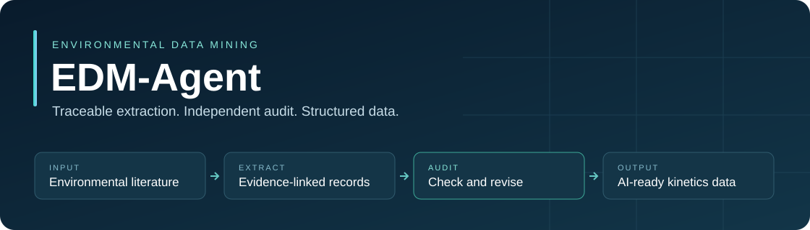

# EDM-Agent



<p align="center"><a href="#run-the-system">Multi-agent system</a> · <a href="#train-a-kinetics-regressor">Kinetics modeling</a> · <a href="https://huggingface.co/HJL-DLUT/EPSciBERT">EPSciBERT</a></p>

Code accompanying **Self-Auditing Multi-Agent Data-Mining System for Transforming Decades of Environmental Photochemistry Literature into AI-Ready Datasets**.

EDM-Agent converts aquatic photochemistry papers into structured environmental kinetics records. The system combines PDF parsing, relevance filtering, schema-constrained extraction, an independent auditing agent, targeted corrections, and spreadsheet export. This repository also contains the regression model definitions used for downstream kinetics modeling.

## Overview

The data-mining controller coordinates document processing, schema-constrained extraction, independent auditing, and targeted re-extraction. Every scientific record retains links to its source paragraphs.


## Contents

```text
system/
  backend/                 Pipeline, agents, schemas, prompts, desktop bridge
  frontend/                Desktop interface and bundled browser dependencies
  data/00_input_pdfs/      Input PDF directory
machine_learning/
  models.py                Regression estimators and their original defaults
  modeling.py              Training and prediction command-line interface
  parameters.json          Endpoint model parameters
```

The application includes the extraction–audit feedback loop, evidence-bearing schemas, and the desktop interface. Regression training accepts prepared feature tables.

## Install

Use Python 3.10–3.12. The desktop interface is primarily intended for Windows.

```powershell
python -m venv .venv
.\.venv\Scripts\Activate.ps1
python -m pip install -r requirements.txt
```

For the multi-agent application alone, install `system/backend/requirements.txt`. For regression modeling alone, install `machine_learning/requirements.txt`.

## Configure the agents

```powershell
Copy-Item system/backend/.env.example system/backend/.env
```

Edit `system/backend/.env` and set `MINERU_API_TOKEN` for PDF parsing. Choose the provider and model for each LLM stage using `STEP1_LLM_PROVIDER`, `STEP2_LLM_PROVIDER`, `STEP3_LLM_PROVIDER`, and the corresponding provider-specific model fields. Model names must be available through your provider account.

| Provider | Credential variable |
| --- | --- |
| `openai` | `OPENAI_API_KEY` |
| `deepseek` | `DEEPSEEK_API_KEY` |
| `qwen` | `QWEN_API_KEY` |
| `openrouter1` | `OPENROUTER1_API_KEY` |
| `openrouter2` | `OPENROUTER2_API_KEY` |
| `zhipu` | `ZHIPU_API_KEY` |
| `chatai` | `CHATAI_API_KEY` (extraction stage) |

ChemSpider and CompTox keys are optional enrichment settings. No credentials are distributed with the code. API request limits, worker counts, reasoning options, and structured-output settings can be configured in the same file.

## Run the system

Place the input papers in `system/data/00_input_pdfs/`, then launch the desktop interface:

```powershell
python system/backend/tdm_bridge.py
```

The interface supports starting, pausing, resuming, and selecting pipeline stages. The command-line entry point runs the full pipeline:

```powershell
python system/backend/0_start.py --mode full
```

| Stage | Operation |
| --- | --- |
| 1 | PDF parsing with MinerU |
| 2 | Parsed JSON collection |
| 3 | Source identifier assignment |
| 4 | Relevance filtering |
| 5 | Extraction input assembly |
| 6 | Structured kinetics extraction |
| 7 | Independent auditing and targeted correction |
| 8 | Chemical enrichment and spreadsheet export |

Run-specific outputs are written under `system/data/runs/`. The final spreadsheet is in the run's `08_final_excel/` directory. The controller retains the extraction–audit feedback loop and pause/resume handling. Runtime summaries report processing status and API usage.

## Train a kinetics regressor

Provide a prepared CSV containing numeric feature columns and a numeric target column, named `target_model` by default. Supply only the feature columns intended for fitting. Handle molecular descriptors, categorical encoding, missing values, and any scaling before passing the table to this entry point. The features used for prediction must have the same names, order, and transformations as the training features. For the kinetics endpoints, `target_model` is `log10(result_value)`.

```powershell
python machine_learning/modeling.py train --input prepared_hl_train.csv --endpoint hl --seed 42 --output outputs/hl_model.joblib
python machine_learning/modeling.py predict --input prepared_hl_predict.csv --model-file outputs/hl_model.joblib --output outputs/hl_predictions.csv
```

Prediction files contain `prediction_model`, in the same target scale used for training. Use `10 ** prediction_model` when the target was log10-transformed.

| Endpoint preset | Selected model |
| --- | --- |
| `hl` | XGBoost |
| `kp` | LightGBM |
| `qy_new_log10` | Extra Trees |
| `kp_augmented_hl` | XGBoost |

Endpoint presets use the selected estimator parameters supplied in parameters.json.

The six regression families reported in the manuscript are Ridge, Random Forest, Extra Trees, LightGBM, XGBoost, and CatBoost. The estimator module also retains the source implementation’s Elastic Net and SVR options. To use an estimator's original defaults instead of an endpoint preset:

```powershell
python machine_learning/modeling.py train --input prepared_train.csv --model random_forest --output outputs/model.joblib
```

## EPSciBERT

The companion [Hugging Face repository](https://huggingface.co/HJL-DLUT/EPSciBERT) contains the domain-adapted EPSciBERT masked-language-model checkpoint and tokenizer. It can supply BERT representations for downstream tasks.

## Third-party components

The frontend bundles React, ReactDOM, Babel, Tailwind CSS, and Three.js. Their copyright and license notices are in [THIRD_PARTY_NOTICES.md](THIRD_PARTY_NOTICES.md).
